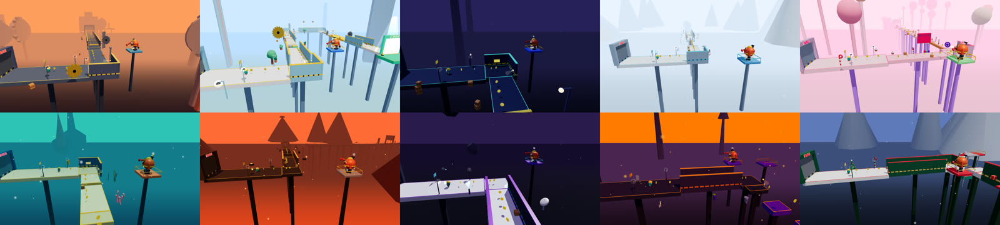

# ESCAPE FACTORY

An original procedural 3D **escape + chase + obstacle-course** game with light horror and
comedy (70 % fun · 20 % tension · 10 % horror, YouTube-safe), built so that **one game
produces many YouTube videos** — and on a reusable framework (**EscapeKit**) for future
games (ESCAPE SCHOOL, ESCAPE HOSPITAL, ESCAPE HOTEL…).

> Build the game for players. Build the system for YouTube. Build the architecture for future games.



## What's inside

| | |
|---|---|
| **Game** | Pip (and 6 more characters) must escape an endless, ever-changing factory while **Grumbo** — a giant, clumsy furnace-robot with a pressure-gauge eye — peeks, chases, blocks doors, lunges and *almost* catches you. |
| **Levels** | Procedural from 19 modules (`seed + difficulty → identical level`), 100-level campaign across 10 themes, boss every 10th level. |
| **Bot** | Plays any level like a person: jumps, rides platforms, times hazards, picks doors, makes (scripted) mistakes. Clears 100/100 levels with every profile and character. |
| **Camera Director** | 13 shot types driven by game events (chase cam when Grumbo is near, dramatic slow-mo on near-death, wide when he appears…). |
| **Video system** | Video configs (`videos/*.json`) → scenarios × takes → **Shorts** (1080×1920, 25–40 s, hook in the first second) and **long videos** (1920×1080, 5–20 min with chapters), rendered frame-exactly to MP4 with a synthesised soundtrack. |
| **Themes** | FACTORY, NORMAL, NIGHT, WINTER (ice), CANDY (jelly), UNDERWATER (floaty), VOLCANO, SPACE (low gravity), HALLOWEEN, CHRISTMAS. |


## Quick start

```bash
cd escape-factory
npm install
npm run dev            # http://localhost:5173  (play)
```

Controls: **WASD / arrows** run · **Space** jump · **Esc / P** pause · **R** restart · **F3** debug overlay.
Gamepad and touch are supported.

### Modes (URL)

| URL | Mode |
|---|---|
| `/` | Game: menu (live bot "attract mode" behind it), levels, characters, settings |
| `/?mode=video&level=5&scenario=CHASE&take=6&format=short` | **VIDEO MODE** — bot plays, director films, no UI ([all params](VIDEO_SYSTEM.md#video-mode-url-parameters)) |
| `/?mode=video&config=video_012` | Preview a bundled config from `videos/` |
| `/?mode=studio` | Video Studio — compose a config, preview, export JSON / CLI command |
| `/?mode=record` | Deterministic recorder (driven by `npm run record`) |
| `/?mode=sandbox&flat&auto&cam=CHASE` | Dev sandbox (camera modes, `&model` character line-up) |

## Making videos

```bash
npm run plan:videos                        # writes videos/video_002…025 + long_05/10/15/20min (verified)
npm run record -- videos/video_001.json    # one Short → out/videos/video_001.mp4 (+ .json .srt .jpg)
npm run record -- videos/                  # every config in the folder
npm run record -- --json '{"level":12,"scenario":"FAIL","take":2}'
npm run record -- videos/long_10min.json --scale 0.5   # long video, draft resolution
npm run record -- --long 15 --start 21                 # 15-minute compilation from level 21
```

Rendering uses headless Chromium. Without a GPU it falls back to SwiftShader (~2.4 fps at
1080×1920). Pass `--gpu` on a machine with a graphics card. See [VIDEO_SYSTEM.md](VIDEO_SYSTEM.md).

## Commands

| Command | |
|---|---|
| `npm run dev` | dev server |
| `npm run build` / `preview` | production build (static site) |
| `npm run typecheck` | TypeScript strict check |
| `npm test` | unit tests (Vitest), including a full 100-level bot run |
| `npm run test:e2e` | browser tests (Playwright): boot, play, video mode, recorder, GPU-leak check |
| `npm run validate:levels -- 1 100 SKILLED [character]` | bot plays the campaign, prints a report |
| `npm run plan:videos` | generate + verify the video series |
| `npm run record -- …` | render videos to MP4 |

## Documentation

- [ARCHITECTURE.md](ARCHITECTURE.md) — technology choice (Phase 0), EscapeKit layers, systems, determinism
- [GAME_DESIGN.md](GAME_DESIGN.md) — loop, Grumbo, characters, modules, difficulty, themes, campaign
- [LEVEL_GENERATOR.md](LEVEL_GENERATOR.md) — seeds, grammar, modules, hints, validation, extending
- [VIDEO_SYSTEM.md](VIDEO_SYSTEM.md) — configs, scenarios, takes, recipes, Shorts/long planners, recorder
- [TESTING.md](TESTING.md) — test suites, bot validation, debug overlay, perf probe
- [DEVELOPMENT_STATE.md](DEVELOPMENT_STATE.md) — completed / current / next / bugs / ADRs
- [KNOWN_ISSUES.md](KNOWN_ISSUES.md)

## Project layout

```
escape-factory/
  src/engine/     EscapeKit — reusable, game-agnostic (sim, physics, level gen, bot, camera, video…)
  src/game/       ESCAPE FACTORY content: characters, Grumbo, themes, campaign, recipes, UI, video app
  src/dev/        sandbox
  videos/         video configs (video_NNN.json, long_NNmin.json) + INDEX.md
  tools/          record, plan-videos, validate-levels, screenshots, traces, perf probe
  tests/unit      Vitest (headless simulation)      tests/e2e   Playwright (real WebGL)
```

All characters, the enemy, the levels and the music are original and procedurally generated
(no external assets).
