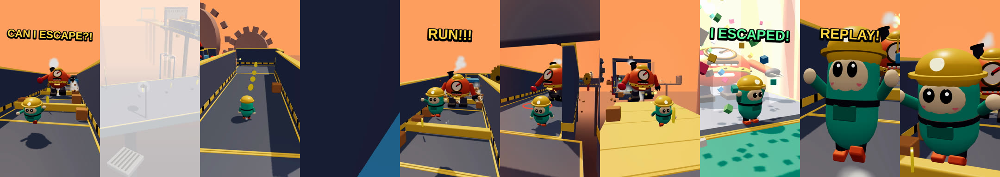
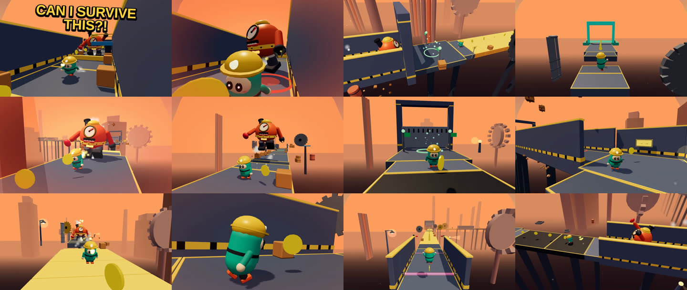

# Video System — one game → many videos

The game doubles as a video factory. Every video is a **config** (`videos/*.json`); a config
plus the game's determinism reproduces the exact same footage forever. Scenarios and takes
turn one level into many different videos; recipes turn the same game into many *concepts*.

## VideoConfig (`videos/video_001.json`)

```json
{
  "id": "video_001",
  "title": "Can I Escape The Factory?",
  "recipe": "CAN_I_ESCAPE",
  "level": 1, "seed": 1001, "difficulty": "EASY", "theme": "FACTORY",
  "character": "pip", "enemy": "grumbo",
  "scenario": "CHASE", "take": 1,
  "cameraStyle": "shorts", "duration": 35, "format": "short", "fps": 30,
  "music": "auto",
  "voice": { "enabled": true, "voice": "en-US-AnaNeural", "lines": [{ "at": 0.2, "text": "Can I escape the factory?" }] },
  "captions": [{ "at": 0, "duration": 1.8, "text": "CAN I ESCAPE?!", "style": "hook" }],
  "events": [],
  "highlight": "auto",
  "meta": { "tags": ["escape", "obby", "chase"], "description": "…" }
}
```

| Field | Meaning |
|---|---|
| `level` | campaign level (fills seed/difficulty/theme unless given explicitly) |
| `seed`, `difficulty`, `length`, `theme`, `specialEvents` | level generator inputs |
| `character`, `enemy` | registry ids (`enemy: "none"` for a calm run) |
| `scenario` | CHASE · NEAR_DEATH · PERFECT_RUN · FAIL · IMPOSSIBLE · BOSS_ESCAPE · CHAOS |
| `take` | 1 PERFECT · 2 ONE_FAIL · 3 NEAR_DEATH · 4 FAST_RUN · 5 CHAOS · 6 ENEMY_ALMOST_CATCHES |
| `takeSeed` | pin the bot's randomness (otherwise derived from seed+take+scenario) |
| `cameraStyle` | dynamic (auto per format) · shorts · smooth · classic · gameplay |
| `duration`, `format`, `fps` | target length; `short` 1080×1920, `long` 1920×1080, `square` 1080×1080 |
| `music` | `auto` (theme music) or `off` |
| `voice` | voice-over lines (exported to metadata for a TTS step) |
| `captions` | `{at, duration, text, style: hook/title/label/outro}`; `atSim` anchors to simulation time |
| `events` | scripted: `camera` (mode, hold, slowmo), `forceMistake` (lateJump, earlyJump, noJump, stop, wrongLane, gateRush), `caption`, `ALARM`, `LIGHTS_FLICKER`, `ENEMY_ROAR`, `SURPRISE`; timed by `at` (video s) or `atS` (track distance) |
| `highlight` | `auto` (best window), `start` (from the beginning), `full` (whole take) |
| `long` | `{minutes, startLevel}` → long-form compilation (see below) |

`validateVideoConfig()` fills defaults and returns errors/warnings instead of throwing; the
unit suite validates every bundled config.

## Scenarios × takes

| Scenario | Level shaping | Performance | Highlight focus |
|---|---|---|---|
| CHASE | +1 chase | skilled bot, aggressive Grumbo | chase, near death, finish |
| NEAR_DEATH | more crushers/lasers/spinners | daredevil bot, closer Grumbo, clean take | near death |
| PERFECT_RUN | — | perfect bot, clean take | finish |
| FAIL | — | scripted dramatic mistake (frozen mid-chase → caught) | fail |
| IMPOSSIBLE | difficulty 5 + chaos | near-perfect, risky bot | near death, chase, boss |
| BOSS_ESCAPE | boss arena | skilled bot | boss |
| CHAOS | chaos + double chase + fallers + traps | average bot | surprise, fail |

Takes layer on top: PERFECT (clean-take search over up to 8 seeds), ONE_FAIL (scripted
mistake), NEAR_DEATH (risky), FAST_RUN (speedrun), CHAOS (chaos surprises), ENEMY_ALMOST_CATCHES
(furious, mercy — never catches). Scripted mistakes are placed where they look best: a
freeze on plain chase ground (Grumbo slows at gaps, so never before a jump), a botched jump
over a static gap, or rushing a hazard gate.

## Recipes (titles that change the content)

`src/game/recipes.ts` — 12 concepts, each = scenario + take + generator flags + hook/climax/
outro captions + tags:
*Can I Escape The Factory? · The Monster Got Faster! · I Almost Died! · Only One Jump Saved
Me! · The Floor Disappeared! · Impossible Factory Escape! · The Monster Was RIGHT Behind Me! ·
Everything Went Wrong! · I Escaped The Factory Boss! · Perfect Run — No Deaths! · He Caught
Me… · Pick The Right Door!*

## Planning a series — `npm run plan:videos`

Builds `video_002 … video_025` (recipes × suitable levels × 7 characters, round-robin) plus
`long_05/10/15/20min.json` and `videos/INDEX.md`. Every Short is **verified headlessly before
it is written**: the take must deliver its title — CAUGHT ends on the catch, PERFECT RUN has
0 deaths, BOSS shows the boss, FLOOR DISAPPEARED shows the collapse on screen, ALMOST DIED
has a near-death moment… — and the edit must land in 25–40 s. Rejected candidates are re-rolled.
The series is deterministic (re-running produces the same files).

## Shorts (1080×1920, 25–40 s)

`planShortEdit()`:

1. Simulate the take headlessly → event log.
2. **Interest curve** (0.1 s grid) from `EVENT_INTEREST` weights, boosted by the recipe/scenario
   focus, plus chase/boss spans.
3. **Best window**: average interest, a strong moment in the first 1.2 s (hook), climax at
   55–88 % of the window, a resolution (finish / chase end / fail) near the end, dead-air
   penalty. Recipes can force the promised moment into the window (`contain`) or end on it
   (`endAt`, fail videos).
4. Structure: **0–1 s hook** (caption in the first frame, never an intro card) · 1–5 action ·
   5–20 escalation · 20–30 climax (caption anchored to the simulation moment) · 30–40 escape/
   fail/loop (outro caption).
5. **Cold open**: if the climax is late and the opening is calm, a 1.4 s slow-motion
   flash-forward of the climax (CHASE camera when Grumbo is involved) comes first.
6. **Instant replay**: if a level is too short, the best non-finish moment is replayed in
   slow motion at the end ("REPLAY!").
7. Exact length is measured headlessly (slow-motion aware) and fitted into 25–40 s.



## Long videos (1920×1080, 5/10/15/20 min)

`planLong()`: consecutive campaign levels, each with the next scenario of a rotating program
(Chase · Near Death · Speedrun · Fail & Retry · Almost Caught · Chaos; boss levels as boss
fights). Cold open = the most intense moment of the whole compilation. Each chapter starts
with a level title card; deaths get a caption; runs over 150 s keep their opening and the
decisive final stretch. The last chapter ends with a "LEVEL N NEXT!" teaser. Length is fitted
to ±3 % by trimming/adding chapters. Chapters are written into the YouTube description.



## Recording — `npm run record`

```
npm run record -- <config.json | folder> [--out out/videos] [--scale 0.5] [--quality 0.9]
                  [--fps 30] [--crf 18] [--gpu] [--no-audio] [--plan-only] [--id name]
npm run record -- --json '{"level":5,"scenario":"FAIL"}'
npm run record -- --long 10 --start 11
```

Pipeline: Vite (in-process) → headless Chromium `?mode=record` → `EditRunner` steps the edit at
exactly `1/fps` (never wall-clock), fast-forwarding unrendered to each cut → JPEG frames
piped to ffmpeg (H.264, yuv420p, faststart; `--scale` renders smaller and upscales) →
soundtrack synthesised from the recorded `AudioTimeline` with OfflineAudioContext in 30 s
chunks (pre-roll joins chunks seamlessly) → AAC, loudness-normalised to −14 LUFS → mux.

Outputs per video:

| File | Content |
|---|---|
| `<id>.mp4` | the video |
| `<id>.json` | title, format, duration, frames, segments (with video start times), chapters, captions, event timeline (video time), sources (configs), YouTube title/description/tags |
| `<id>.srt` | subtitles from the captions |
| `<id>.jpg` | thumbnail (climax frame) |

Speed: SwiftShader (no GPU) ≈ 2.4 fps at 1080×1920, ≈ 5 fps at half-scale 1080p; a real GPU
(`--gpu`) is many times faster.

## VIDEO MODE (preview) — URL parameters

`/?mode=video&…` — `config` (bundled name), `level`, `seed`, `difficulty`, `length`, `theme`,
`character`, `enemy`, `scenario` (or `VIDEO_SCENARIO`), `take`, `takeSeed`, `camera`,
`format`, `duration`, `fps`, `highlight`, `events` (comma list of special events), `hook`.
No UI is shown; the bot plays; the director films; the preview loops. Click to enable sound.

## Video Studio — `/?mode=studio`

Pick preset/recipe/level/seed/difficulty/theme/character/enemy/scenario/take/camera/format/
duration/hook, preview live, export the JSON and copy the matching `npm run record` command.

## Camera director in videos

Styles are data tables (`camera/styles.ts`): event → shot rules (priority, hold, cooldown,
chance, slow-mo, cut) and coverage rotations. Shorts use portrait framing and more close/
chase shots; long videos use wider coverage. 13 modes: FOLLOW, SIDE, FRONT, BACK, TOP, LOW,
WIDE, CLOSE, CHASE, DRAMATIC, IMPACT, SLOW, FINISH (gallery: `docs/img/camera_gallery.png`).

Camera collision (`camera/CameraCollision.ts`) runs after the director in `GameSession`
(headless too): the camera rises over or eases in front of walls, ceilings, floors, large
decor, crusher heads and Grumbo, keeps 0.35 m clearance, eases back when free, and turns a
shot that can't be kept smoothly into a director cut. CHASE/WIDE then re-frame runner and
chaser (`camera/framing.ts`). Quality: `npm run audit:camera` (see TESTING.md).
